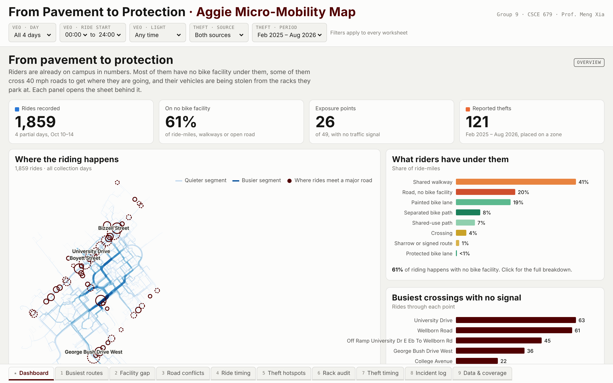

# TAMU Micromobility

A visual analytics dashboard on e-scooter and bike use on the Texas A&M
campus. It covers where and when people ride, where the infrastructure falls
short, and where thefts and conflicts happen. Built with Python and D3.js as
a course project.

[](docs/images/dashboard-preview.png)

One screen: an OpenStreetMap campus map in the middle, cropped to the area
the theft reports cover, with switchable layers for the busiest routes,
conflict points and theft zones. Smaller views sit either side of it, and
one filter shelf narrows everything. **[Open the live dashboard](https://prat-yush.github.io/TAMU-Micromobility/)**, or [run it locally](#setup).

There's no server. Scrapers collect raw data, a Python pipeline turns it into
static JSON, and the D3 frontend loads that JSON directly from GitHub Pages.
Every change to `frontend/` on `main` redeploys it (`.github/workflows/pages.yml`).

```
scrapers/  ──►  data/raw/  ──►  backend/  ──►  frontend/data/  ──►  frontend/ (D3, GitHub Pages)
                data/reference/ ──┘
```

## Repo layout

| Folder | What goes here |
|---|---|
| `scrapers/` | One folder per external source (Veo GBFS, UPD crime alerts, Clery log, GIS layers, news). Each writes to the matching folder in `data/raw/`. |
| `data/raw/` | Scraper output. Treat as append-only. |
| `data/reference/` | Hand-made inputs: dismount zones, news metadata, academic calendar, sunset times. |
| `data/interim/` | Intermediate pipeline output. Not committed; the pipeline can regenerate it. |
| `backend/geo/` | Shared ~500 ft grid and zone definitions. Every section uses the same geography. |
| `backend/processing/` | Cleaning, trip inference, spatial joins. |
| `backend/analysis/` | Metrics and scoring. |
| `backend/export/` | Writes the final JSON into `frontend/data/`. |
| `frontend/` | The D3 dashboard. `js/sections/` holds one module per dashboard section, and `js/components/` holds shared pieces (map, tooltip, legend). |
| `docs/` | Proposal, reports, diagrams. |

`frontend/data/` is where backend and frontend meet. If you change the shape of
a JSON file there, say so in your PR.

For what's in those files, every field, and how the backend makes them, see
[backend/README.md](backend/README.md).

For how the areas connect and what belongs in each folder, see
[ARCHITECTURE.md](ARCHITECTURE.md).

## Setup

Python 3.12+.

```bash
python3 -m venv .venv
source .venv/bin/activate
pip install -r requirements.txt -r requirements-dev.txt
pre-commit install   # optional: auto-formats your code on commit
```

Run the frontend locally with any static server:

```bash
python3 -m http.server 8000 --directory frontend
# open http://localhost:8000
```

## Contributing

See [CONTRIBUTING.md](CONTRIBUTING.md).
